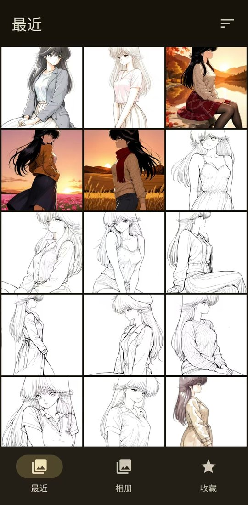
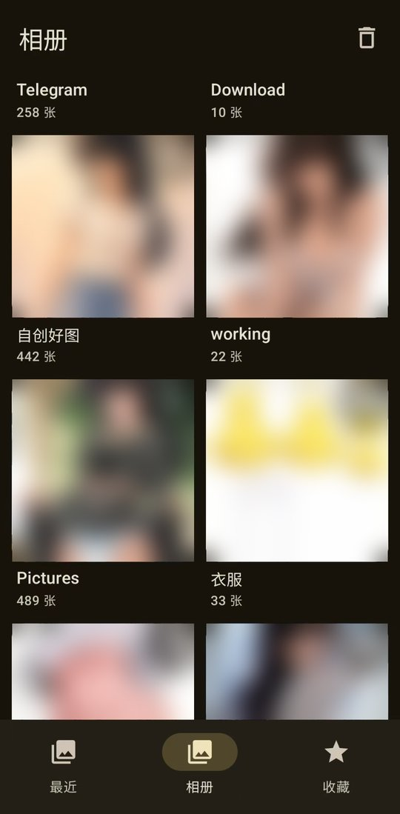
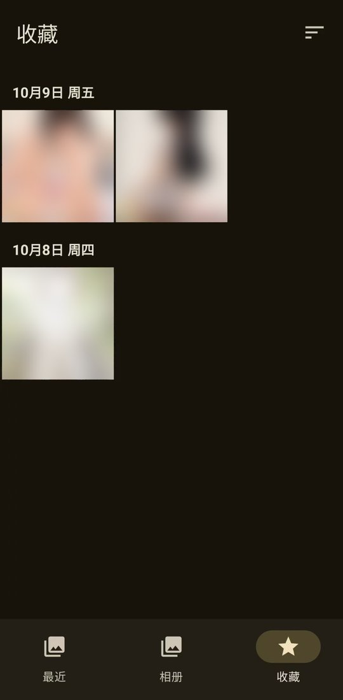
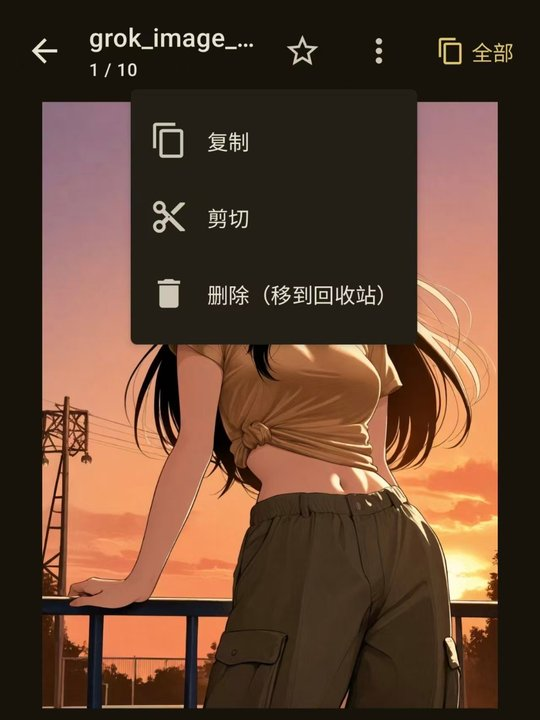
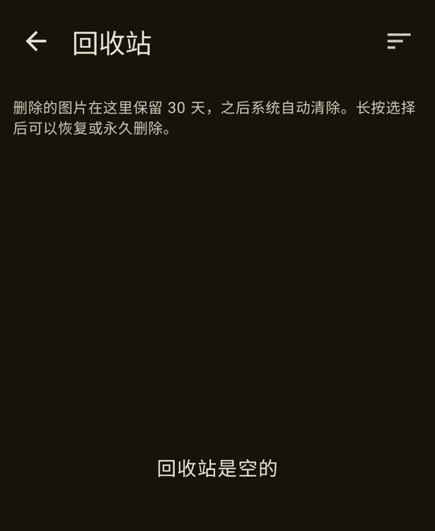

<div align="center">

# PromptLens

**查看 AI 生成图片里的提示词和参数，同时管理手机相册的安卓应用**


**简体中文** | English（即将推出）

[下载最新版](../../releases/latest) · [使用说明](#使用说明) · [更新日志](CHANGELOG.md)

</div>

---

## 目录

- [简介](#简介)
- [界面预览](#界面预览)
- [主要功能](#主要功能)
- [系统要求](#系统要求)
- [安装](#安装)
- [使用说明](#使用说明)
  - [最近](#最近)
  - [相册](#相册)
  - [收藏](#收藏)
  - [排序](#排序)
  - [复制、剪切与粘贴](#复制剪切与粘贴)
  - [删除与回收站](#删除与回收站)
  - [全屏看图](#全屏看图)
  - [查看生成信息](#查看生成信息)
- [支持的生成信息格式](#支持的生成信息格式)
- [权限与隐私](#权限与隐私)
- [常见问题](#常见问题)
- [从源码构建](#从源码构建)
- [更新日志](#更新日志)
- [许可证](#许可证)

---

## 简介

用 ComfyUI、Stable Diffusion WebUI 等工具生成的图片，会把提示词（prompt）、采样器、步数、种子等信息悄悄写在图片文件里。
可手机自带的相册既看不到这些信息，也不方便整理成百上千张生成图。

**PromptLens** 把这两件事合在一起：

- **看得见**：点开任何一张图，就能看到它的正向 / 负向提示词和全部生成参数，每一项都能一键复制，拿去复现或改写。
- **管得好**：按日期浏览全部图片，常用文件夹钉在最上面，喜欢的图一键收藏；复制、移动、删除和回收站一应俱全。
- **够安全**：不联网、不上传，所有处理都在手机上完成；移动和删除都要经过系统确认，误删可以从回收站找回。

## 界面预览

<table>
  <tr>
    <td align="center"><br><b>最近</b><br>按日期浏览全部图片</td>
    <td align="center"><br><b>相册</b><br>所有文件夹，常用的可钉选</td>
    <td align="center"><br><b>收藏</b><br>喜欢的图集中查看</td>
  </tr>
  <tr>
    <td align="center"><br><b>大图页</b><br>收藏、复制、剪切、删除</td>
    <td align="center"><br><b>回收站</b><br>恢复、永久删除、清空</td>
    <td></td>
  </tr>
</table>

<sub>示例截图中的图片已做模糊处理。</sub>

## 主要功能

| 功能 | 说明 |
|---|---|
| 🔎 **全屏看图** | 双指缩放、拖动查看细节，双击铺满屏幕，左右滑动切换图片 |
| 📷 **最近** | 按日期分组浏览手机里的全部图片（今天、昨天、具体日期） |
| 📁 **相册** | 列出所有含图片的文件夹，常用文件夹可以**钉选**在最上方 |
| ⭐ **收藏** | 一键收藏，集中查看喜欢的图片 |
| ↕️ **排序** | 按**时间、文件名、大小**排序，支持正序 / 倒序 |
| ✂️ **文件操作** | 复制、剪切、粘贴、删除（移到回收站），支持多选 |
| ♻️ **回收站** | 恢复误删的图片，或永久删除、一键清空 |
| 🔍 **生成信息** | 读取正向 / 负向提示词、采样器、步数、CFG、种子等参数，每项都能单独复制 |
| 📤 **外部打开** | 在其他应用里「分享」或「打开方式」选择 PromptLens，直接查看单张图片的信息 |

## 系统要求

- Android **11** 或更高版本
- 首次启动需要授予「访问照片」权限

## 安装

1. 打开本仓库的 [Releases](../../releases) 页面，下载最新的 `PromptLens-v*.apk`。
2. 在手机上打开 APK 文件安装。如果系统提示「禁止安装未知来源应用」，按提示允许本次安装即可。
3. 已安装旧版本（包括更名前的「PNG Info」）的，可以直接覆盖安装，收藏和设置都会保留。

> 首次打开时请选择 **「允许全部」** 照片访问。如果只允许了部分照片，应用顶部会显示提示条，点「允许全部」即可重新授权。

## 使用说明

底部有三个标签页：**最近**、**相册**、**收藏**。

### 最近

显示手机里的全部图片，默认按时间从新到旧排列，并按日期分组。点击图片进入大图和生成信息页面，左右滑动切换图片。

### 相册

列出手机里所有包含图片的文件夹，显示封面和图片数量。

- **钉选文件夹**：点文件夹封面右上角的 📌 图钉，该文件夹会固定在「已钉选」区域，方便直接进入；再点一次取消钉选。
  进入文件夹后，右上角也有同样的图钉按钮。
- **回收站**：「相册」页右上角的 🗑 图标。

### 收藏

- 在大图页面点右上角的 ⭐ 星标，或者长按选中多张后点底部的「收藏」。
- 收藏过的图片会在缩略图左下角显示一颗小星标。
- 收藏信息只保存在本应用里，不会同步到系统相册。图片被移动到其他文件夹后，收藏依然保留。

### 排序

点右上角的排序按钮，选择排序方式：

| 排序方式 | 默认顺序 | 再点一次 |
|---|---|---|
| 时间 | 新 → 旧 | 旧 → 新 |
| 文件名 | A → Z | Z → A |
| 大小 | 大 → 小 | 小 → 大 |

- 按文件名或大小排序时，缩略图右下角会显示文件名或文件大小，方便对照。
- 排序设置会自动记住，所有标签页通用。

### 复制、剪切与粘贴

1. **长按**一张图片进入多选模式，继续点其他图片可以多选，顶部可以「全选」。
2. 点底部的「**复制**」或「**剪切**」。
3. 切换到「**相册**」，打开目标文件夹，点右上角的「**粘贴**」。

- 复制是**完整复制原文件**，图片里的生成信息会原样保留。目标文件夹里有同名文件时，新文件会自动改名。
- 剪切（移动）时，系统会弹出确认框，点「允许」后完成移动。
- 在大图页面，右上角「⋮」菜单里也可以复制、剪切单张图片。
- 安卓系统不允许写入其他应用的私有文件夹（例如 `Android/media/` 下的文件夹），粘贴到这类文件夹会提示失败。
  `DCIM`、`Pictures`、`Download` 下的文件夹都可以正常粘贴。

### 删除与回收站

**删除**：长按选中图片后点底部的「删除」，或在大图页面「⋮」菜单里选「删除」。确认后，图片会被移到系统回收站。

**回收站**：在「相册」页点右上角的 🗑 进入。

| 操作 | 方法 |
|---|---|
| 恢复 | 长按选中图片 → 点「恢复」。图片会回到原来的文件夹 |
| 永久删除 | 长按选中图片 → 点「永久删除」 |
| 清空回收站 | 点右上方的「清空」 |

- 永久删除和清空回收站会先由应用确认一次，再由系统确认一次，**删除后无法恢复**。
- 回收站里的图片保留 **30 天**，之后由系统自动永久删除。
- 本应用使用的是安卓系统回收站，与部分手机自带相册的回收站（例如三星相册）**互不相通**。在本应用里删除的图片，请在本应用的回收站中恢复。

### 全屏看图

在详情页**点击图片**进入全屏：

| 手势 | 效果 |
|---|---|
| 双指张开 / 捏合 | 放大 / 缩小（最大 8 倍），以双指中心为准 |
| 放大后单指拖动 | 移动画面查看细节 |
| 双击 | 原大小时：以双击位置为中心**铺满屏幕**（竖图适应宽度、横图适应高度）；已放大时：恢复完整显示 |
| 左右滑动 | 原大小时切换上一张 / 下一张；放大后改为拖动画面 |
| 单击 / 返回键 / 左上角 ✕ | 退出全屏，详情页会停在最后看的那一张 |

- 全屏时按原图清晰度加载（最长边不超过 4096 像素），放大后细节依然清楚。
- 放大时底部会显示当前缩放比例。

### 查看生成信息

点击任意图片进入详情页：

- 上方显示图片，点击进入[全屏看图](#全屏看图)。
- 下方依次显示：**来源软件**、**正向提示词**、**负向提示词**、**生成参数**、**原始元数据**。
- 每一项都有「复制」按钮；右上角的「全部」按钮可以把所有信息按 A1111 格式一次复制。
- 如果图片没有生成信息（例如被聊天软件压缩过、截图或经过其他软件转存），会显示「没有找到生成信息」。

> **提示**：通过 Telegram 等聊天软件以「照片」方式发送的图片会被压缩，生成信息会丢失；以「文件」方式发送则会保留。

## 支持的生成信息格式

| 来源 | 文件格式 | 读取方式 |
|---|---|---|
| ComfyUI | PNG / WebP | 从节点图追踪正 / 负提示词与采样参数（优先使用 `prompt`，没有时使用 `workflow`） |
| Stable Diffusion WebUI（A1111）/ Forge | PNG / JPG / WebP | `parameters` 文本 / EXIF `UserComment` |
| Fooocus、SwarmUI | PNG | JSON 格式的参数 |
| NovelAI | PNG | `Comment` / `Description` |
| InvokeAI | PNG | `invokeai_metadata` |

无法识别的格式，也可以在「原始元数据」里查看并复制全部原始文本。

## 权限与隐私

| 权限 | 用途 |
|---|---|
| 访问照片（`READ_MEDIA_IMAGES`） | 显示图片、读取生成信息 |
| 部分照片访问（`READ_MEDIA_VISUAL_USER_SELECTED`） | 安卓 14 起，用户只允许访问部分照片时使用 |

- **不需要网络权限**，所有处理都在手机本地完成，不收集、不上传任何数据。
- 移动、删除、恢复、永久删除等修改操作，每次都会弹出安卓系统确认框，经你同意后才会执行。

## 常见问题

**问：为什么有些图片显示「没有找到生成信息」？**
答：图片经过压缩、截图或被其他软件重新保存后，生成信息会丢失。请尽量使用原始文件。

**问：在三星相册里看不到本应用删除的图片？**
答：本应用使用安卓系统回收站，与三星相册的回收站不同，请在本应用的回收站中查看和恢复。

**问：粘贴时提示失败？**
答：目标文件夹可能是其他应用的私有文件夹，安卓不允许写入。请选择 `DCIM`、`Pictures`、`Download` 下的文件夹。

**问：只看到部分照片？**
答：首次授权时可能选择了「仅允许部分照片」。点击顶部提示条的「允许全部」，或在系统设置 → 应用 → PromptLens → 权限里修改。

## 从源码构建

需要 JDK 17 和 Android SDK（compileSdk 35）。

```bash
git clone <本仓库地址>
cd PromptLens
./gradlew assembleRelease
```

生成的安装包位于 `app/build/outputs/apk/release/app-release.apk`。

| 项目 | 内容 |
|---|---|
| 语言 / 界面 | Kotlin、Jetpack Compose、Material 3 |
| 图片加载 | Coil |
| 元数据读取 | 自行解析 PNG 文本块（tEXt / iTXt / zTXt）；JPG / WebP 使用 AndroidX ExifInterface |
| 相册与文件操作 | Android MediaStore |

## 更新日志

详见 [CHANGELOG.md](CHANGELOG.md)。

## 许可证

本项目以 [MIT 许可证](LICENSE) 发布。
